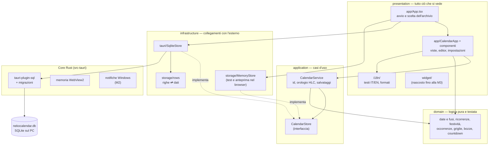

# Architettura di NekoCalendar

NekoCalendar è un'app **Tauri 2** con interfaccia in **React + TypeScript**. Tutto funziona sul PC; Supabase arriverà solo per account e sincronizzazione (ADR-0002). Le scelte sono motivate negli [ADR](adr/).

## Livelli

Il frontend è diviso in livelli e le dipendenze vanno sempre verso il dominio ([ADR-0005](adr/0005-architettura-a-livelli.md)); ESLint blocca gli import nel verso sbagliato.

## Regole

- **`src/domain`** non importa Tauri, React né il DOM: si testa in Node e si riusa sul futuro Android.
- **`src/application`** conosce solo l'interfaccia `CalendarStore`, non le implementazioni: nei test e nell'anteprima riceve `MemoryStore`, nell'app `SqliteStore`. Così le stesse operazioni sono verificate senza Windows.
- **`src/infrastructure/tauri`** è l'unico posto che chiama Tauri. `src/presentation` sceglie quale archivio usare all'avvio (`App.tsx`) e non importa mai `@tauri-apps/*` direttamente.
- **Il core Rust** resta piccolo: plugin, migrazioni, poche API di Windows dietro `#[cfg(windows)]`.

## Flusso di una modifica

1. L'utente salva il modulo → `EventEditor` produce una **bozza** (`EventDraft`).
2. `validateDraft` controlla la bozza; gli errori sono chiavi di traduzione mostrate accanto al campo.
3. `CalendarService.saveDraft` assegna l'id (UUID v7) e il timestamp **HLC**, e chiama `store.saveEvent`.
4. `SqliteStore` scrive con un **upsert parametrico** (mai valori dentro l'SQL).
5. L'interfaccia ricarica i dati; `buildOccurrences` espande le ricorrenze solo per l'intervallo visibile.

## Date, fusi e ricorrenze

- Le ore si salvano come le legge l'orologio (`"2026-11-02T18:30"`) insieme al fuso IANA dell'evento (`"Europe/Rome"`).
- Le ricorrenze (RRULE, RFC 5545) si espandono con **ical.js** sull'orologio dell'evento: "ogni lunedì alle 18:30" resta alle 18:30 anche dopo il cambio dell'ora legale.
- Solo dopo l'espansione le ore si convertono nel fuso del PC. Ora inesistente (marzo): si sposta in avanti. Ora ripetuta (ottobre): vale la prima.
- Le eccezioni (cancellare o spostare **una sola** ripetizione) sono righe a parte (`event_exceptions`), identificate dall'inizio originale dell'occorrenza.

## Avvio

1. Tauri applica le migrazioni del database (`plugins.sql.preload` in `tauri.conf.json`).
2. `App.tsx` apre `SqliteStore` e chiama `CalendarService.start`, che al primo avvio crea l'id del dispositivo e i tre calendari predefiniti.
3. Se qualcosa va storto compare un messaggio con "Riprova"; un `ErrorBoundary` protegge anche dagli errori dell'interfaccia.

## Prestazioni

- Si carica tutto in memoria una volta (centinaia o migliaia di eventi) e si espande solo l'intervallo della vista.
- L'ora corrente si aggiorna **una volta al minuto**, mai al secondo; nessun polling.
- Il codice del database si carica solo dentro Tauri (import dinamico).
- Il mese misura l'altezza delle righe con un `ResizeObserver` (solo quando la finestra cambia dimensione) per decidere quanti eventi mostrare per casella.

## Aspetto (tema base)

- Direzione "Latte & Fusa" ([ADR-0008](adr/0008-direzione-latte-e-fusa.md)): colori, raggi, ombre e curve sono token in `src/presentation/theme/tokens.css`.
- **Colori degli eventi** (`presentation/app/eventPalette.ts`): otto tinte, ognuna con `--ev-<nome>-tint|stripe|ink` per chiaro e scuro. Nel database si salva il colore della striscia; `hueOf` riconduce qualsiasi colore (anche delle versioni precedenti) alla tinta più vicina e `eventStyle` imposta le variabili CSS `--event-tint`, `--event-color` e `--event-ink` sull'elemento.
- **Icone degli eventi**: `suggestIcon` (dominio, `domain/eventIcon.ts`) sceglie l'icona dal titolo e dal tipo; `presentation/app/emoji.ts` trova il file (Fluent Emoji, 3D o piatto) in `src/presentation/assets/emoji/`. Le icone restano file separati, non incorporati nel JavaScript.

## Movimento

- Durate e curve sono token del tema (`--motion-fast`, `--motion-normal`, `--motion-slow`, `--ease-*` in `tokens.css`): uno Style Pack potrà cambiarli.
- Ogni animazione risponde a un gesto (o all'apertura dell'app), dura tra 150 e 450 ms con le curve di Material 3 (`--ease-enter`, `--ease-exit`, `--ease-standard`), non blocca i clic e **non gira all'infinito**: a riposo il consumo resta zero.
- La direzione del cambio di periodo viene da `useCalendarApp` (`transition`: avanti, indietro, vista, oggi); la vista entra con una nuova chiave React.
- **View Transitions** (`motion/viewTransition.ts`): il browser fotografa la schermata prima e dopo un cambio di stato (applicato con `flushSync`) e anima il passaggio. La vista corrente si chiama `page` (scorrimento di lato per avanti/indietro, dissolvenze); l'elemento che si trasforma si chiama `vt-morph` e il nome passa dall'elemento piccolo (giorno, evento, pulsante) a quello grande (vista Giorno, finestra) tra le due foto. `<html data-vt>` dice al CSS quale effetto usare.
- Viste e finestre decidono **una volta sola, quando nascono**, se entrare con la loro animazione CSS o lasciare fare alla View Transition (`isInsideTransition`), così le due non si sommano e nulla riparte a fine transizione.
- **Molle**: curve elastiche scritte con `linear()` nei token (`--ease-spring`, `--ease-spring-soft`).
- **Festeggiamenti** (`motion/celebrate.ts`): otto zampette animate con le Web Animations quando si completa un'attività, rimosse dopo 0,65 secondi.
- Niente librerie. Senza supporto alle View Transitions il cambio avviene subito con le animazioni CSS; con "Riduci animazioni" di Windows (`prefers-reduced-motion`) non parte nulla.
